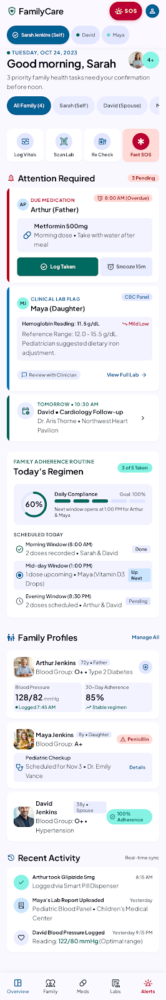

# 🩺 SwasthSathi (स्वस्थ साथी) — Family Health & Clinical Care Platform

<div align="center">



<br/><br/>

**An intelligent, offline-first clinical family health management operating system and emergency triage platform tailored for Indian households.**  
Engineered with **React 18**, **TypeScript**, **Vite**, **Tailwind CSS**, and **IndexedDB**, powered by **Plus Jakarta Sans**, **Material Symbols**, and **Google Stitch Modernized Clinical Design**.

[](https://react.dev/)
[](https://www.typescriptlang.org/)
[](https://vitejs.dev/)
[](https://tailwindcss.com/)
[](LICENSE)
[](https://developer.mozilla.org/en-US/docs/Web/API/IndexedDB_API)
[](https://abdm.gov.in/)

</div>

---

## 🌟 Executive Overview & Mission

In Indian joint and nuclear families, healthcare management is almost always multi-generational: adult children actively coordinate elderly parents' chronic diabetic and cardiac regimens while nurturing young children's nutritional and developmental milestones. 

**SwasthSathi (स्वस्थ साथी)** serves as a **unified family health command center** that bridges daily prescription adherence, laboratory diagnostic intelligence, pre-visit physician preparation, and stress-resilient emergency triage into a single, cohesive, offline-capable progressive web application.

### Why SwasthSathi?

- **100% Offline-First Architecture**: Powered by client-side IndexedDB (`SwasthSathiIndianV2`), ensuring all medical records, emergency contacts, allergy profiles, and prescription schedules remain accessible during remote travel or cellular network dropouts.
- **Dedicated Indian Context & Pharmacology**: Pre-configured with authentic Indian family profiles, localized medication brandings (e.g., Metformin, Amlodipine, Glipizide, Atorvastatin), leading diagnostic laboratory templates (Dr. Lal PathLabs, Apollo Diagnostics, SRL Diagnostics), and emergency dispatch protocols (`112` National Emergency & `108` Ambulance).
- **Clinical Safety & Zero Data Loss Safeguards**: Critical biomarkers, severe allergy contraindications, and clinical inquiry agendas are protected by multi-step safety acknowledgment modals with auto-cancel timers.
- **Multi-Generational Triage**: Seamlessly switch between parents, children, and spouses with instant updates across dosages, clinical flags, and appointments.

---

## 👨‍👩‍👧‍👦 Profile Model: The Kumar Family

SwasthSathi comes pre-seeded with a clinical profile model reflecting multi-generational Indian household dynamics:

| Member | Age & Role | Clinical Summary & Chronic Profile | Primary Caregiver / Attending Physician |
| :--- | :--- | :--- | :--- |
| **Harikit Kumar** | **38 yrs**<br/>Self • Family Caregiver • Admin | Healthy baseline; coordinates family appointments, medication logistics, and emergency dispatch proxies (`harikit@swasthsathi.in`). | Primary Family Administrator |
| **Rajesh Kumar (Dad)** | **68 yrs**<br/>Father • Patriarch | **Type 2 Diabetes Mellitus**, **Hypertension**, post-PCI status with **Drug-Eluting Cardiac Stent (LAD Artery - 2021)**. Severe allergy: Sulfa Antibiotics & Latex. | **Dr. Rahul Sharma, MD**<br/>(Fortis Escorts Heart Institute) |
| **Priya Kumar** | **36 yrs**<br/>Spouse • Co-Administrator | **Essential Hypertension** (managed with Amlodipine 5mg); full health proxy signer and 100% daily adherence tracker. | **Dr. Rajesh Gupta, MD**<br/>(AIIMS New Delhi) |
| **Ananya Kumar** | **8 yrs**<br/>Daughter • Pediatric Profile | **Mild Low Iron / Microcytic Anemia trend** (Hgb 11.5 g/dL); seasonal wellness, active Delhi Public School (DPS) health record. Moderate allergy: Penicillin. | **Dr. Neha Sharma, MD**<br/>(Apollo Children's Clinic, Saket) |

---

## 🚀 Core Functional Modules

### 1. Family Health Dashboard & Daily Compliance
- **Dynamic Time-of-Day Clinical Greeting**: Welcomes the primary caregiver (**Harikit Kumar**) with active family status indicators.
- **Attention Required Priority Feed**:
  - **Overdue Medication Alert**: Live alert for **Rajesh's Metformin 500mg (Post-Breakfast)** with interactive `Log Taken` (with audio-tactile feedback) and `Snooze 15m` controls.
  - **Flagged Clinical Lab Alert**: Highlights **Ananya's Hemoglobin (11.5 g/dL - Mild Low)** with pediatric nutritional recommendations and direct links to Dr. Lal PathLabs reports.
  - **Upcoming Appointment Spotlight**: Follow-up details for upcoming cardiology consultations with **Dr. Rahul Sharma**.
- **Daily Regimen Dial**: SVG Circular progress gauge visualizing family-wide compliance alongside morning, mid-day, and evening schedule blocks.
- **Family Profile Telemetry**: Instant blood pressure readouts, blood group callouts, active condition tags, and allergy warnings for every family member.

### 2. Routine Dose Tracking & 7-Day Adherence Strip (MediScan)
- **7-Day Micro Calendar Strip**: Real-time adherence indicators for each day of the week, featuring an active 14-day streak flame badge and daily completion percentages.
- **Dose Event Bento Gauge**: Radial progress gauge visualizing daily doses taken (e.g., *4 of 7 Doses Taken*).
- **Chronological Regimen Timeline**:
  - **Morning Window (8:00 AM)**: Completed doses (*Amlodipine 5mg*, *Glipizide 5mg*) with timestamp audit trail.
  - **Mid-Day Window (1:00 PM)**: Scheduled pediatric doses (*Vitamin D3 Drops*, *Elemental Iron Drops*) with one-tap `Log Dose` and `Snooze` controls.
  - **Evening Window (8:30 PM)**: Scheduled maintenance therapy (*Lisinopril 10mg*, *Atorvastatin 10mg*).
- **Rx Check & Drug Interaction Matrix**: Local offline pharmacology database screening contraindications (e.g., Warfarin + Ibuprofen, Metformin + Contrast Dye) plus AI clinical mechanism analysis.

### 3. Lab Report Scanner & Clinical Biomarker Extraction
- **Diagnostic Template Support**: Pre-configured for **Dr. Lal PathLabs**, **Apollo Diagnostics**, and **SRL Diagnostics** Complete Blood Count (CBC), Lipid Panel, and Metabolic profiles.
- **High-Accuracy Extraction Preview**: Document preview card featuring an **OCR confidence badge (98.4%)** and patient record identifier (`#SS-89420`).
- **Biomarker Extraction Grid**:
  - **Hemoglobin**: `11.5 g/dL` (Ref: 12.0–15.5) — `Mild Low` indicator with dietary iron guidance.
  - **Hematocrit**: `34.2%` (Ref: 35.0–45.0) — `Mild Low` correlation.
  - **WBC & Platelets**: `6,800 /µL` & `245,000 /µL` — `Normal` indicators.
  - **Serum Iron & Ferritin**: `48 µg/dL` & `16 ng/mL` — `Low` indicators.
- **One-Tap Verification & Print**: Export and save approved reports into the permanent patient health record or print an official clinical summary.

### 4. Emergency Medical SOS & Live Hospital Triage
- **High-Stress Contrast Dialer**: Instant direct cellular call trigger to **112 National Emergency** (`tel:112`) and **108 Ambulance Services**.
- **Rapid Triage Patient Selector**: Horizontal selector with blood group callouts (*Rajesh Kumar • 68 yrs • BLOOD O+*).
- **Sub-Emergency Triggers**:
  - **Broadcast SOS**: Triggers instant emergency SMS dispatch to verified family proxies (**Priya Kumar**, **Harikit Kumar**).
  - **Share GPS Fix**: Captures live location telemetry (*28.5672° N, 77.2100° E - New Delhi*).
- **First-Responder Paramedic Brief**:
  - Severe allergies & contraindications (*Sulfa Antibiotics - Severe Anaphylaxis*, *Latex*).
  - Active chronic conditions (*Type 2 Diabetes*, *Hypertension*).
  - Implanted medical devices (*Drug-eluting Cardiac Stent - LAD Artery, 2021*).
- **Nearest Trauma ER Card**: Direct telemetry for **AIIMS New Delhi Emergency Trauma Centre** (Sri Aurobindo Marg, Ansari Nagar, New Delhi • 1.8 km / 5 min), open bed count (12 ER Beds Open), navigation routing, and direct ER desk dialer (`011-26588500`).

### 5. Pre-Visit Clinical Agenda & Consultation Planner
- **Doctor Consultation Spotlight**: Countdown pill (*Tomorrow • 10:30 AM IST*), pre-check-in status (90%), clinic address (**Apollo Children's Clinic • Saket Sector 6, New Delhi**), and driving directions.
- **Correlated Diagnostic Lab Reference**: Direct link to Dr. Lal PathLabs CBC findings (*Mild Low Iron / Hgb 11.5*).
- **Doctor Agenda Checklist**:
  - Priority-1 Lab Suggested Flag: *"Discuss Ananya's declining hemoglobin trend (11.5 g/dL) — should we start elemental iron drops or pediatric supplements?"*
  - Parent observations on mild afternoon fatigue and school sleep schedule.
  - Medical paperwork tracking for **Delhi Public School (DPS)** annual health authorisations.
- **Quick-Add Agenda Input**: Voice note trigger and instant question logging for upcoming clinical consultations.

### 6. Clinical Safeguards & Privacy Controls
- **Caregiver Security Card**: Harikit Kumar (Admin • `harikit@swasthsathi.in`), Tier-3 Biometric Passcode (FaceID / TouchID / Device Credential).
- **Auto-Archive Safeguards**: Prevents accidental or unauthorized deletion of clinical agenda questions, allergy profiles, and lab flags.
- **Configurable Retention Period**: Segmented selector for `6 Months`, `1 Year`, or `Indefinitely`.
- **Care Team Sharing Permissions**: Role-based access for family proxies (**Priya Kumar**) and verified physicians (**Dr. Neha Sharma, MD**).
- **Risk Acknowledgment Modal**: 12-second auto-dismiss countdown bar that pauses on mouse hover, preventing unintended safeguard deactivation.

---

## 🏗 System Architecture & Data Flow

```mermaid
graph TD
  User([User / Family Caregiver: Harikit Kumar]) --> WebApp[SwasthSathi Modern Web App]

  subgraph Frontend [React 18 + TypeScript + Vite]
    Header[Header & Family Context Switcher]
    Dash[Dashboard & Attention Triage Hub]
    Meds[MediScan: Dose Tracker & Interactions]
    Labs[Dr. Lal PathLabs Scanner & Biomarker Extraction]
    SOS[112 Emergency SOS & AIIMS Trauma ER]
    Agenda[Pre-Visit Agenda & Doctor Notes]
    Safe[Clinical Safeguards & Risk Modal]
    BottomNav[5-Tab Persistent Navigation]
  end

  subgraph OfflineDataLayer [Browser-Native Offline Engine]
    IDB[(IndexedDB: SwasthSathiIndianV2)]
    KB[Pharmacology & Drug Interaction Matrix]
    ML[Naive Bayes Offline Symptom Classifier]
  end

  subgraph BackendServices [Express.js Backend & AI Proxy]
    API[/api/v1/health]
    AIProxy[Gemini AI / Hybrid Clinical Fallback]
  end

  WebApp --> Header
  WebApp --> BottomNav
  Header --> Dash
  BottomNav --> Meds
  BottomNav --> Labs
  BottomNav --> SOS
  BottomNav --> Agenda
  Header --> Safe

  Dash <--> IDB
  Meds <--> IDB
  Labs <--> IDB
  SOS <--> IDB
  Meds <--> KB
  SOS <--> ML
  Labs --> API
  API --> AIProxy
```

---

## 💻 Technology Stack & Design Specifications

| Category | Technology | Specification & Role |
| :--- | :--- | :--- |
| **Frontend Framework** | **React 18.3** | Concurrent rendering, hooks (`useMemo`, `useCallback`, `useContext`) |
| **Language** | **TypeScript 5.9** | Strict type definitions across members, prescriptions, vitals, labs, and appointments |
| **Build & Tooling** | **Vite 7.3** | Sub-second Hot Module Replacement (HMR) and tree-shaken production bundles |
| **Design System** | **Tailwind CSS 3.3** + **Google Stitch** | Modern clinical design tokens: `#006194` (Primary Blue), `#006a61` (Teal), `#ba0035` (Emergency Red), `#faf8ff` (Surface) |
| **Typography & Icons** | **Plus Jakarta Sans** + **Material Symbols** | High-legibility medical UI typography and variable symbol fonts |
| **Offline Storage** | **IndexedDB (`idb` v8)** | Local storage for family profiles, appointments, medications, vitals, and lab records |
| **Backend API** | **Node.js + Express + TypeScript** | Health check endpoints, AI proxy assistance, and document parsing endpoints |
| **Emergency Standards** | **National Emergency `112`** | 1-tap direct dialer, live GPS telemetry, and first-responder triage briefs |

---

## 🛠 Getting Started & Local Development

### Prerequisites
- **Node.js**: v18.0.0 or higher
- **npm** or **bun** / **yarn**

### 1. Clone the Repository
```bash
git clone https://github.com/satyamk001-tech/SwasthSathi.git
cd SwasthSathi
```

### 2. Install Dependencies
```bash
npm install
```
*(This command installs root dependencies and cascades into `frontend` and `backend`).*

### 3. Run the Development Servers
```bash
npm run dev
```
- **Frontend Web Application**: [`http://localhost:5173`](http://localhost:5173)
- **Backend API Server**: [`http://localhost:5000`](http://localhost:5000)

### 4. Build for Production
```bash
npm run build
```
Generates fully optimized production assets in `frontend/dist` and compiled JavaScript in `backend/dist`.

---

## 🚑 Indian Emergency Health Numbers Reference

SwasthSathi integrates standard Government of India emergency telecommunication protocols:

| Service | Emergency Number | Dispatch Purpose |
| :--- | :--- | :--- |
| **National Emergency Helpline** | **`112`** | Unified single emergency response service (Police, Fire, Ambulance) |
| **Ambulance Services** | **`108`** / **`102`** | Free ambulance transport for emergency trauma and maternal care |
| **AIIMS Trauma Centre ER** | **`011-26588500`** | Direct triage desk for AIIMS New Delhi Level-1 Trauma Centre |
| **National Health Portal Helpline** | **`1800-180-1104`** | Tele-health advisory and national health scheme support |

---

## 🔒 Privacy, Security & ABDM Readiness

1. **Zero Cloud Requirement for Critical Vitals**: All core family records, medication logs, and lab values operate directly in local browser IndexedDB storage without mandatory cloud synchronization.
2. **Affirmative Consent Safeguards**: Deletion or disabling of clinical records requires interactive user verification with a 12-second pause-on-hover safety countdown.
3. **Paramedic First-Responder Accessibility**: Blood groups, stent implantation status, and severe drug contraindications are accessible immediately from the SOS view without locking or authentication barriers.
4. **Data Portability**: Complete personal health records can be exported at any time as standard JSON for clinician sharing or hospital migration.

---

<div align="center">

**SwasthSathi (स्वस्थ साथी)** — *Empowering Indian Families with Dignity, Precision, and Life-Saving Care.*  
Licensed under the [MIT License](LICENSE).

</div>
