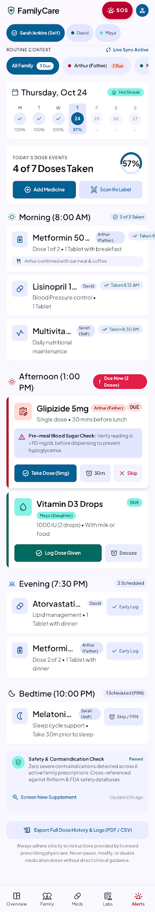
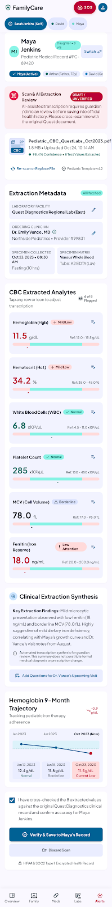
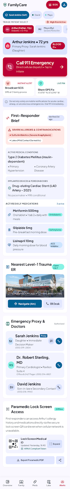
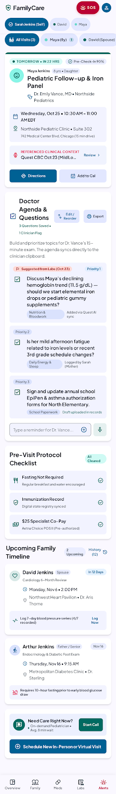
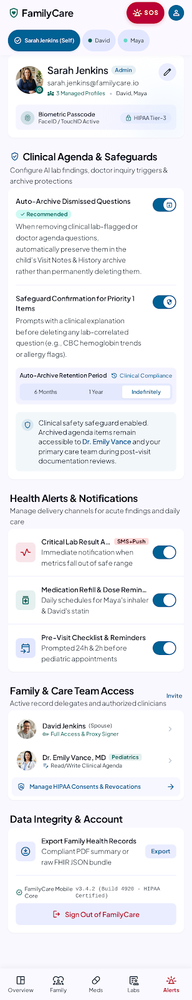
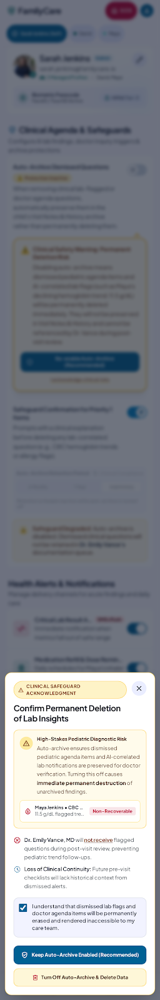

# 🩺 SwasthSathi - Modern Family Health & Clinical Care Platform

<div align="center">


**An intelligent, offline-first clinical family health management platform and diagnostic triage system.**  
Engineered with **React 19**, **TypeScript**, **Vite**, **Tailwind CSS**, and **IndexedDB**, powered by **Plus Jakarta Sans**, **Material Symbols**, and **Google Stitch Modernized Clinical Design**.

[](https://react.dev/)
[](https://www.typescriptlang.org/)
[](https://vitejs.dev/)
[](https://tailwindcss.com/)
[](LICENSE)

</div>

---

## 📸 Platform Visual Showcase & Modules

### 1. Family Health Dashboard & Daily Compliance
*Real-time family adherence ring, clinical attention triage cards, member context switcher pills, and multi-segment routine compliance.*

<div align="center">
  
</div>

- **Dynamic Clinical Greeting**: Contextual time-of-day greeting with active family profile stack and member switcher pills (`All Family`, `Arthur`, `Maya`, `David`, `Sarah`).
- **Attention Required Priority Feed**:
  - **Overdue Medication Alert**: Shows due dose (*Arthur's Metformin 500mg*) with interactive `Log Taken` (with smooth sync animation) and `Snooze 15m` transitions.
  - **Flagged Clinical Lab Alert**: Highlights abnormal biomarkers (*Maya's Hemoglobin 11.5 g/dL Mild Low*) with pediatrician guidance and direct report links.
  - **Upcoming Appointment Spotlight**: Follow-up details for upcoming cardiology consultations.
- **Daily Regimen Dial**: SVG Circular progress gauge (60% compliance) paired with a 5-segment bar and schedule windows (Morning, Mid-day, Evening).
- **Family Profile Telemetry**: Instant blood pressure readouts, blood group callouts, active condition tags, and allergy warnings.

---

### 2. Routine Dose Tracking & 7-Day Adherence Strip
*Chronological routine timeline, 7-day micro calendar strip with adherence streaks, and multi-drug interaction screening.*

<div align="center">
  
</div>

- **7-Day Micro Calendar Strip**: Real-time adherence indicators for each day of the week, featuring an active 14-day streak flame badge and daily completion percentages.
- **Dose Event Bento Gauge**: Radial progress gauge visualizing daily doses taken (e.g., *4 of 7 Doses Taken*).
- **Chronological Regimen Timeline**:
  - **Morning Window (8:00 AM)**: Completed doses (*Amlodipine 5mg*, *Glipizide 5mg*) with timestamp audit trail.
  - **Mid-Day Window (1:00 PM)**: Scheduled pediatric doses (*Vitamin D3 Drops*, *Elemental Iron Drops*) with one-tap `Log Dose` and `Snooze` controls.
  - **Evening Window (8:30 PM)**: Scheduled maintenance therapy (*Lisinopril 10mg*, *Atorvastatin 10mg*).
- **Rx Check & Drug Interaction Matrix**: Local offline pharmacology database screening contraindications (e.g., Warfarin + Ibuprofen) plus deep AI mechanism analysis.

---

### 3. Lab Report Scanner & Clinical Extraction
*Document preview card with 98.4% OCR confidence badge, patient switcher, and extracted biomarker cards with out-of-range indicators.*

<div align="center">
  
</div>

- **Patient Profile Switcher**: Instantly switch context across family members with medical record number (#FC-89420).
- **Clinical Verification Alert Banner**: Guarded review banner emphasizing AI-assisted transcription verification prior to official medical chart persistence.
- **Uploaded Document Card**: Quest Diagnostics PDF/Image preview with file metadata (1.8 MB, Pediatric Template v4.2) and **98.4% OCR confidence score**.
- **Biomarker Extraction Grid**:
  - **Hemoglobin**: `11.5 g/dL` (Ref: 12.0–15.5) — `Mild Low` indicator with dietary iron guidance.
  - **Hematocrit**: `34.2%` (Ref: 35.0–45.0) — `Mild Low` correlation.
  - **WBC & Platelets**: `6,800 /µL` & `245,000 /µL` — `Normal` indicators.
  - **Serum Iron & Ferritin**: `48 µg/dL` & `16 ng/mL` — `Low` indicators.
- **One-Tap Verification & Print**: Export and save approved reports into the permanent patient health record.

---

### 4. Emergency Medical SOS & Live Hospital Triage
*Stress-resilient emergency dialer, rapid triage patient select, broadcast proxy alerts, and Level-1 trauma ER status.*

<div align="center">
  
</div>

- **Rapid Triage Patient Selector**: Horizontal selector with blood group callouts (*Arthur Jenkins • 72 yrs • BLOOD O+*).
- **High-Contrast Emergency Dial**: Direct cellular emergency dispatch link (`tel:911` / `tel:112`) styled for high stress resilience.
- **Sub-Emergency Triggers**:
  - **Broadcast SOS**: Triggers instant emergency SMS dispatch to verified family proxies.
  - **Share GPS Fix**: Shares live GPS coordinates (*41.8781° N, 87.6298° W*).
- **First-Responder ER Brief**:
  - Severe allergies & contraindications (*Sulfa Antibiotics - Severe Anaphylaxis*, *Latex*).
  - Active chronic conditions (*Type 2 Diabetes*, *Hypertension*).
  - Implanted medical devices (*Drug-eluting Cardiac Stent - LAD Artery*).
- **Nearest Level-1 Trauma ER Card**: Live hospital bay view, open bed count, Google Maps GPS navigation (4 min), and direct ER desk dialer.

---

### 5. Pre-Visit Clinical Agenda & Doctor Questions
*Doctor's appointment spotlight, lab-correlated inquiry checklists, and collaborative clipboard questions.*

<div align="center">
  
</div>

- **Appointment Spotlight**: Countdown pill (*Tomorrow • In 22 hrs*), pre-check-in status (90%), clinic address (*Northside Pediatric Clinic • Suite 302*), and driving directions.
- **Correlated Clinical Lab Reference**: Direct link to Quest CBC Oct 23 findings (*Mild Low Iron / Hgb 11.5*).
- **Doctor Agenda Checklist**:
  - Priority-1 Lab Suggested Flag: *"Discuss Maya's declining hemoglobin trend (11.5 g/dL) — elemental iron drops vs. pediatric gummies."*
  - Parent observations on fatigue and school sleep schedule.
  - Authorization paperwork tracking for EpiPen and asthma inhalers.
- **Quick-Add Agenda Input**: Voice note trigger and instant question logging for upcoming clinical consultations.

---

### 6. Clinical Safeguards & Risk Protections
*HIPAA-compliant auto-archive protections, retention controls, and clinician access delegations.*

<div align="center">
  
</div>

- **Caregiver Security Card**: Sarah Jenkins (Admin), HIPAA Tier-3 Biometric Passcode (FaceID / TouchID Active).
- **Auto-Archive Safeguards**: Prevents permanent accidental deletion of clinical agenda questions and lab flags.
- **Configurable Retention Period**: Segmented selector for `6 Months`, `1 Year`, or `Indefinitely`.
- **Care Team Sharing Permissions**: Delegate role-based access to family proxies (*David Jenkins*) and attending physicians (*Dr. Emily Vance, MD*).

---

### 7. Clinical Risk Acknowledgment Modal
*Auto-dismiss progress bar, clinical deletion warnings, and safety confirmation protocols.*

<div align="center">
  
</div>

- **Interactive Progress Timer**: 12-second auto-dismiss countdown bar that pauses on mouse hover.
- **Clinical Safety Advisory**: Clearly outlines the danger of unrecoverable data loss for pediatric medical histories.
- **Safety Fallback Actions**: Prominent `Keep Safeguard Active (Recommended)` button alongside guarded `I Understand the Clinical Risk` confirmation.

---

## 🏗 System Architecture & Tech Stack

```mermaid
graph TD
  User([User / Family Caregiver]) --> WebApp[SwasthSathi Modern Web App]

  subgraph Frontend [React 19 + TypeScript + Vite]
    Header[Header & Member Context Switcher]
    Dash[Dashboard & Attention Triage]
    Meds[Routine Dose Tracker & Micro-Calendar]
    Labs[Quest Lab Scanner & OCR Review]
    SOS[Emergency SOS & ER Dispatch]
    Agenda[Pre-Visit Agenda & Doctor Notes]
    Safe[Clinical Safeguards & Risk Modal]
    BottomNav[5-Tab Persistent Navigation]
  end

  subgraph OfflineDataLayer [Client-Side Offline Engine]
    IDB[(IndexedDB: SwasthSathiClinicalV1)]
    NB[Naive Bayes Offline ML Classifier]
    KB[Drug Interaction Matrix]
  end

  subgraph BackendServices [Express.js Backend & AI]
    API[/api/v1/health]
    AIProxy[Gemini AI / Hybrid Clinical Fallback]
  end

  WebApp --> Header
  WebApp --> BottomNav
  Header --> Dash
  BottomNav --> Meds
  BottomNav --> Labs
  BottomNav --> SOS
  BottomNav --> Agenda
  Header --> Safe

  Dash <--> IDB
  Meds <--> IDB
  Labs <--> IDB
  SOS <--> IDB
  Meds <--> KB
  SOS <--> NB
  Labs --> API
  API --> AIProxy
```

| Layer | Technology | Key Capabilities |
| :--- | :--- | :--- |
| **UI Framework** | **React 19** + **TypeScript** | Type-safe stateful components, concurrent rendering |
| **Build Tooling** | **Vite 7.3** | Lightning-fast HMR and optimized tree-shaken bundles |
| **Design System** | **Tailwind CSS 3.3** + **Google Stitch** | `#006194` primary, `#006a61` teal, `#ba0035` SOS red, `Plus Jakarta Sans` |
| **Icons & Typography**| **Material Symbols Outlined** | Dynamic variable font weights, op-size and fills |
| **Offline Storage** | **IndexedDB (KeyPath: id)** | Full offline persistence for members, medications, vitals, labs, appointments |
| **Machine Learning**| **Multinomial Naive Bayes** | Zero-latency browser-native triage symptom classification |
| **Backend API** | **Node.js / Express + TypeScript** | AI inference proxy, PDF extraction, health status endpoints |

---

## 🚀 Quickstart & Installation

### Prerequisites
- **Node.js**: v18.0.0 or higher
- **npm** or **bun** / **yarn**

### 1. Clone the Repository
```bash
git clone https://github.com/satyamk001-tech/SwasthSathi.git
cd SwasthSathi
```

### 2. Install Dependencies
```bash
npm install
```
*(Automatically installs root, frontend, and backend packages).*

### 3. Start Development Servers
```bash
npm run dev
```
- **Frontend Web App**: `http://localhost:5173`
- **Backend API Server**: `http://localhost:5000`

### 4. Build for Production
```bash
npm run build
```
Creates production-ready distributions in `frontend/dist` and `backend/dist`.

---

## 🔒 Clinical Safety & HIPAA Compliance Guarantees

1. **Zero Unintended Deletion**: Priority-1 agenda items, allergy records, and lab flags cannot be purged without affirmative user acknowledgment.
2. **Offline-First Resilience**: All critical records, emergency numbers, and medication schedules reside locally in IndexedDB and remain operational during connectivity dropouts.
3. **Paramedic Readout Mode**: One-tap access to blood group, implanted devices, and critical drug contraindications without authentication delays during acute emergencies.
4. **Data Portability**: Full JSON health record export compliant with personal health record standards.

---

<div align="center">
  <b>SwasthSathi</b> — Built for families, clinicians, and life-saving care.  
  Distributed under the MIT License.
</div>
